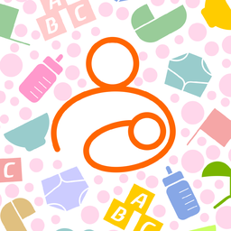
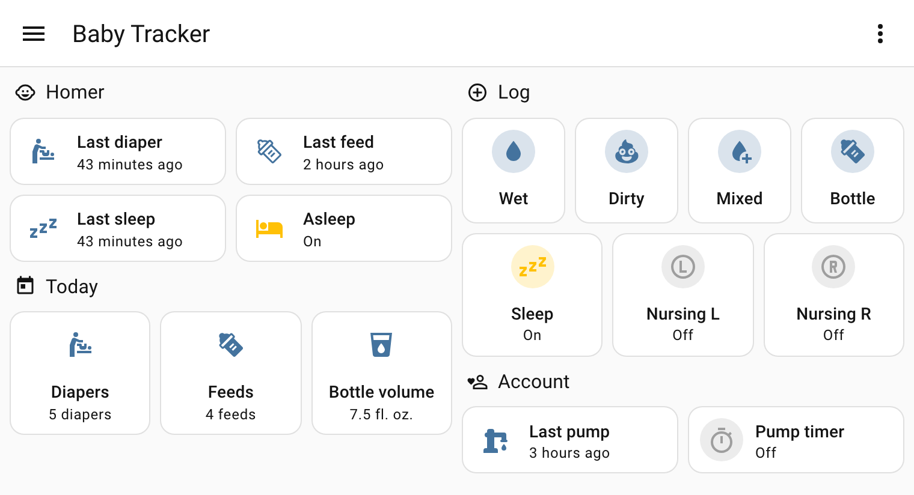

<p align="center">
  
</p>

# Baby Tracker (Nighp) for Home Assistant

A custom integration for the [Baby Tracker](https://apps.apple.com/us/app/baby-tracker-newborn-log/id779656557)
app by [Nighp](https://nighp.com). Home Assistant signs in to your account's sync service, shows
each baby's last diaper, feed, and sleep, and logs new ones from buttons, switches, and actions.

This integration is not made or supported by Nighp, the maker of Baby Tracker. For help, open an
issue in this repository; please don't contact Nighp.

<p align="center">
  
</p>

## What you get

Each baby in the account becomes a device with:

| Entity | What it shows or does |
|---|---|
| **Last diaper**, **Last feed**, **Last sleep** | When it happened, with the details (type, amount, sides, note) as attributes. The newest of nursing, formula, and pumped milk is the last feed. |
| **Asleep** | On while the baby's newest sleep is running, started from any device. |
| **Diapers today**, **Feeds today**, **Bottle volume today** | Counts since local midnight. They chart and keep long-term statistics. |
| **Wet diaper**, **Dirty diaper**, **Mixed diaper**, **Bottle** buttons | Log that record now. The bottle is the one set in the options. |
| **Sleep**, **Nursing left**, **Nursing right** switches | Start and stop timers. See [Timers](#timers). |
| **Nursing left time**, **Nursing right time**, **Discard nursing** | The running nursing session's minutes per side, and a way to drop it. |
| **Sleep timer**, **Nursing timer** | When the running timer started, for a [live activity](#live-activity-on-your-iphone). |

Each account becomes a device with **Last pump**, a **Pump timer** switch, and a **Pump timer**
sensor showing when it started, because the app stores pumps on the account, not on a baby. Babies added to the account later show up without a
restart.

## Installation

It needs Home Assistant 2026.10.0 or later. The integration isn't in HACS yet, so install it by
copying:

1. Copy `custom_components/baby_tracker` from this repository to
   `<config>/custom_components/baby_tracker/`.
2. Restart Home Assistant.

The library that talks to the service is bundled inside the integration, so there is nothing else
to install.

## Configuration

1. Go to **Settings > Devices & services > Add integration** and choose **Baby Tracker (Nighp)**.
2. Enter the email and password you use in the app.

Home Assistant loads the account's history once, then checks for new records every 5 minutes.
Records it writes itself show at once. It signs in as its own device, named "Home Assistant",
which appears in the app's device list after its first record.

**Options:** **Bottle size**, **Bottle unit**, and **Bottle type** set what each **Bottle** button
logs. The default is 4 fl. oz. of formula, or 120 mL in a metric unit system.

If the password changes, Home Assistant asks you to sign in again.

## Timers

- **Sleep** is on while the baby's newest sleep is running, wherever it started. Turn it on to
  start a sleep and off to end it, even one a phone started. The app syncs a running sleep, so the
  phones see it at their next sync.
- **Nursing left** and **Nursing right** work like the app's side buttons. Turn a side on to
  start, turn the other side on to switch, and turn the lit side off to stop and log the session.
  The app doesn't sync a running nursing timer, so these show only Home Assistant's own timer, and
  the phones see the session when it stops.
- **Pump timer** works the same way for the account. Stopping it logs the minutes with no amount;
  to save the amount too, call `baby_tracker.stop_pump` with `amount`.

Nursing and pump timers survive a restart. One left running for over an hour raises a repair.

## Actions

A baby's actions take the baby's device as `device_id`. The account's actions take
`config_entry_id`, and `undo` takes either. **Developer tools > Actions** shows every field.

| Action | What it does |
|---|---|
| `baby_tracker.log_diaper` | Log a wet, dirty, or mixed diaper. |
| `baby_tracker.log_bottle` | Log a formula or pumped-milk bottle. |
| `baby_tracker.log_nursing` | Log a finished nursing session by side. |
| `baby_tracker.log_sleep` | Log a finished sleep. |
| `baby_tracker.log_pump` | Log a pump on the account, as a total or by side. |
| `baby_tracker.start_sleep`, `baby_tracker.stop_sleep` | Start or end the baby's sleep timer. |
| `baby_tracker.start_nursing`, `baby_tracker.switch_nursing_side`, `baby_tracker.stop_nursing`, `baby_tracker.discard_nursing` | Run Home Assistant's nursing timer. |
| `baby_tracker.start_pump`, `baby_tracker.stop_pump` | Run the account's pump timer. `stop_pump` takes an optional `amount`. |
| `baby_tracker.undo` | Delete the newest record Home Assistant wrote, or one by `object_id`. |

Times default to now, except for `log_sleep`, which needs a start and an end. The `log_*` actions
and `start_sleep` take an optional `object_id`; reuse it to retry a write safely, and the record is
added once.

## Live activity on your iPhone

The blueprint `blueprints/automation/baby_tracker/live_activity.yaml` shows a running sleep or
nursing timer as an iOS Live Activity through the Home Assistant Companion app. Import it from
**Settings > Automations & scenes > Blueprints > Import blueprint** with
`https://github.com/wtadler/ha-baby-tracker/blob/main/blueprints/automation/baby_tracker/live_activity.yaml`,
then create one automation per baby and phone with that baby's **Sleep timer** and **Nursing
timer** sensors and the phone's `notify.mobile_app_…` action.

It needs iOS 17.2 or later and Home Assistant 2026.7.0 or later. Sleeps show from any device;
nursing shows only for Home Assistant's own timer.

## Use cases

**A crib-side button.** Map a physical button to `button.press` on **Wet diaper** or **Bottle**.
One press logs the record, and `baby_tracker.undo` fixes a mistaken one.

**A 3 a.m. dashboard.** Like the one above: the last-activity sensors read "23 minutes ago", and
the **Sleep** and nursing switches start and stop timers in one tap.

**Quiet the house while the baby sleeps.**

```yaml
automation:
  - alias: Quiet mode while the baby sleeps
    triggers:
      - trigger: state
        entity_id: binary_sensor.baby_asleep
        to: ["on", "off"]
    actions:
      - action: "input_boolean.turn_{{ trigger.to_state.state }}"
        target:
          entity_id: input_boolean.quiet_mode
```

**A daily intake check.** Alert at 8 p.m. when `sensor.baby_feeds_today` is below 4.

## Known limitations

- **Records arrive every 5 minutes.** Call `homeassistant.update_entity` on any Baby Tracker
  entity to check sooner.
- **A nursing timer running on a phone isn't visible** until it stops, because the app doesn't sync
  it.
- **The service has no public API.** The integration speaks the app's own sync protocol, documented
  from observed traffic in `PROTOCOL.md`. Nighp can change it without notice.
- **Undo only removes Home Assistant's own records.** Delete the phones' records in the app.
- **A sleep is at most 24 hours,** and nursing and pump sides at most 240 minutes.

## Troubleshooting

**A sensor looks stale or unavailable.** Phone records arrive within 5 minutes. If the sensors are
unavailable, the sync is failing; the Home Assistant log has the error.

**A repair says a timer has run for over an hour.** It was probably forgotten. Turn off its switch
to save it, or press **Discard nursing** to drop a nursing one.

**A repair says Baby Tracker can't write for your account.** Writing is paused so nothing is
skipped or overwritten. Delete the account's entry under **Settings > Devices & services** and add
it again with the same email and password.

**A write says "the last entry is still being confirmed."** The service didn't answer the last
write. Try again in a minute.

**Reporting a bug:** on the integration's page, choose **Download diagnostics** and attach it to an
[issue](https://github.com/wtadler/ha-baby-tracker/issues). It redacts the email, password, and
device ID, and holds no baby's name and no notes.

## Removing a baby

A baby deleted in the app is removed from Home Assistant at the next sync, with its device and
entities.

## Removal

1. Under **Settings > Devices & services**, open **Baby Tracker (Nighp)** and choose **Delete**.
2. Delete `custom_components/baby_tracker` and restart Home Assistant.

The "Home Assistant" device stays in the app's device list.

## Contributing

See [CONTRIBUTING.md](CONTRIBUTING.md) for development setup and the plan for core submission.
